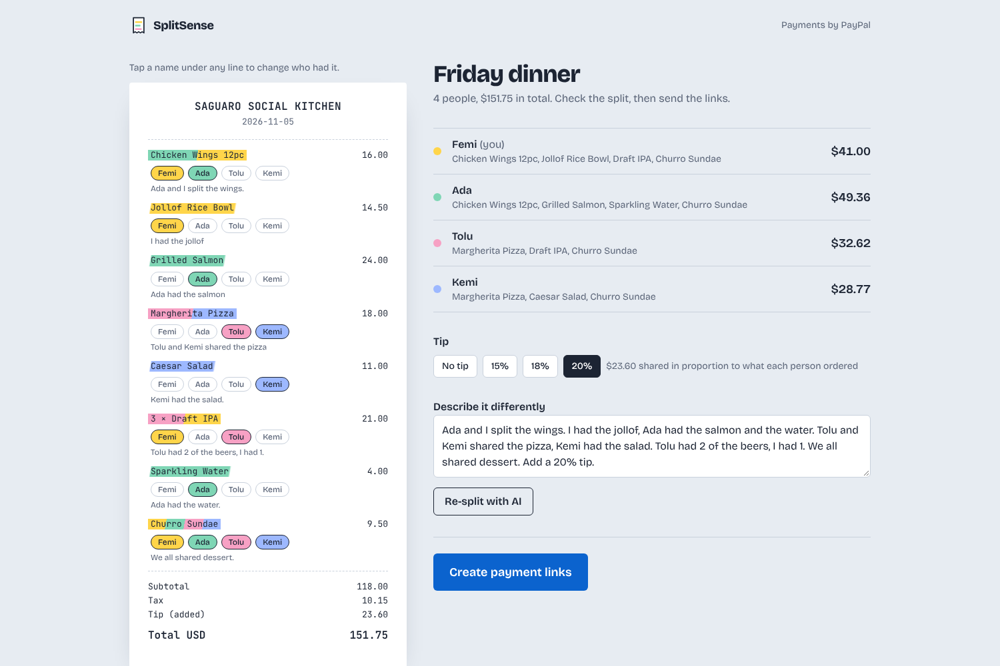
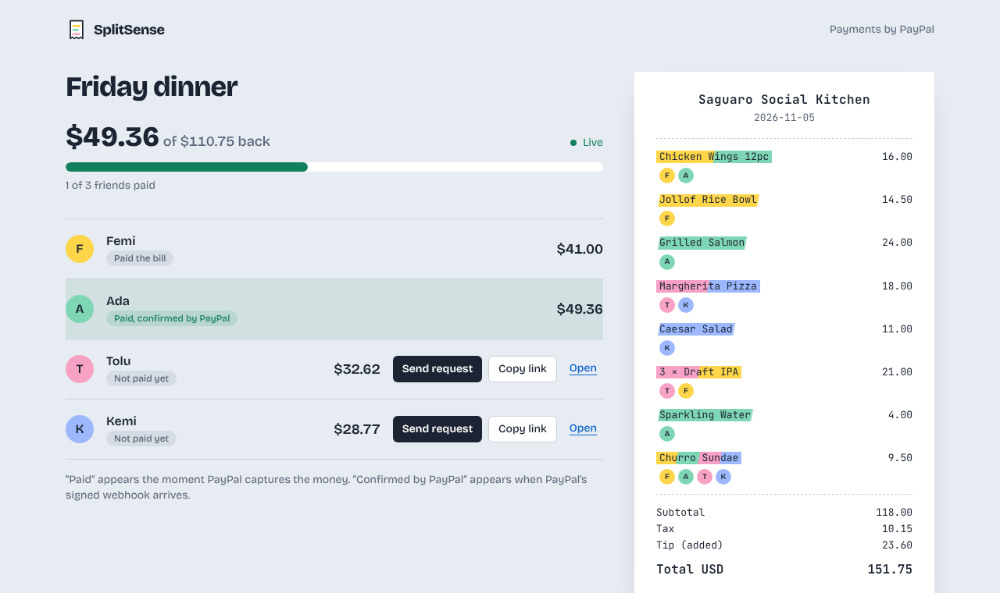
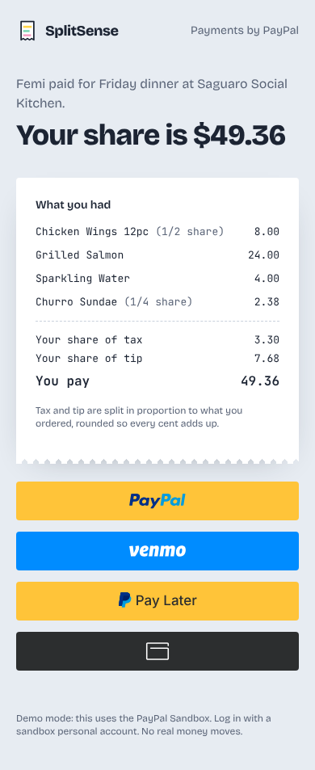

# SplitSense

**Snap the receipt. Say who had what. Everyone pays their exact share with PayPal.**

SplitSense is for the person who covered dinner. Claude reads the receipt and checks its own math. An AI agent turns one plain-English sentence ("Ada and I split the wings, Tolu had 2 of the beers, add 20% tip") into an exact split, down to the cent. Each friend gets a PayPal link for exactly what they owe, and you watch the payments land live.

Built for the **PayPal AI Hackathon 2026** with PayPal Orders v2, PayPal webhooks and Anthropic Claude.



| Live dashboard | Friend's payment page (mobile) |
|---|---|
|  |  |

---

## Features

**AI**
- **Receipt vision with self-verification.** Claude reads photos or PDFs into line items, tax, tip, fees and discounts. The agent checks that items add up to the subtotal and the components add up to the total. If they don't, the exact mismatch goes back to the model so it can re-read the receipt (up to `AI_MAX_RETRIES`).
- **Natural-language allocation.** "I", "everyone", nicknames, "2 of the 3 beers" and "add 18% tip" all work. Unknown names, made-up items and skipped items are rejected with feedback, and the agent corrects itself.
- **Strict structured output.** Both steps are forced tool calls with JSON schemas, mirrored by zod validation on the server.
- **The AI decides who had what, and code decides how much.** The largest-remainder method guarantees shares sum exactly to the bill, with no lost pennies.
- **Live progress.** The AI steps stream to the browser as NDJSON: reading, checking the math, matching items, computing shares.

**PayPal**
- **Orders v2 with a full item breakdown.** Each friend sees "Chicken Wings (1/2 share), Tip (your share)" on the PayPal review page.
- **Smart Payment Buttons** (`@paypal/react-paypal-js`): PayPal, Venmo, Pay Later and card.
- **OAuth 2.0 token caching** with early refresh, single-flight deduplication, and automatic retry after a 401.
- **Idempotent capture** (`PayPal-Request-Id`). Already-captured orders and declined funding (`actions.restart()`) are handled.
- **Verified webhooks** (`verify-webhook-signature` with the raw body spliced in byte for byte). Events are deduplicated by ID and checked against the expected amount.
- **Recovery.** If a buyer approves and closes the tab, the `CHECKOUT.ORDER.APPROVED` webhook triggers a server-side capture.
- **Live host dashboard** over Server-Sent Events. "Paid" when the capture succeeds, "Confirmed by PayPal" when the signed webhook arrives.

**Product**
- Highlighter-marked receipt with each friend in their own color. Tap any line to change who had it.
- Tip presets, re-splitting with new wording, and warnings when the AI wasn't sure.
- Share links that work with the phone's native share sheet. No account needed for friends.
- A bundled sample receipt, so the whole flow can be tried without a photo.

## Repository layout

```
splitsense/
├── LICENSE                     MIT
├── README.md
├── .env.example                every variable, documented
├── render.yaml                 one-click Render Blueprint
├── package.json                npm workspaces: server + web
├── samples/
│   └── sample-receipt.png      fictional receipt for demos
├── docs/
│   ├── ARCHITECTURE.md         concept, stack, data flow, security
│   ├── SUBMISSION.md           video script + Devpost answers
│   └── screenshots/
├── server/                     Express 5 + TypeScript API
│   ├── src/
│   │   ├── index.ts            boot + graceful shutdown
│   │   ├── config.ts           zod-validated environment
│   │   ├── server.ts           routes, webhook handler, errors
│   │   ├── ai_agent.ts         Claude prompts, tool schemas, retry loop
│   │   ├── paypal.ts           OAuth, Orders v2, webhook verification
│   │   ├── money.ts            cents math, largest-remainder split
│   │   ├── bills.ts            shares, PayPal order mapping, views
│   │   ├── db.ts               SQLite repository
│   │   └── events.ts           Server-Sent Events hub
│   └── test/                   Vitest + Supertest (34 tests)
└── web/                        React 19 + Vite + Tailwind 4
    └── src/
        ├── components/
        │   ├── PaymentCheckout.tsx   PayPal Smart Buttons ↔ backend
        │   ├── Receipt.tsx           highlighter receipt
        │   ├── StatusBadge.tsx
        │   └── Spinner.tsx
        ├── pages/
        │   ├── NewBill.tsx           upload + AI progress
        │   ├── BillPage.tsx          review (draft) + live dashboard
        │   └── PayShare.tsx          friend's checkout
        └── lib/ (api.ts, format.ts)
```

## Prerequisites

- **Node.js 22.13 or newer** (22 LTS or later, including 24 and 26; `.nvmrc` included). The database is Node's built-in SQLite, so nothing native is compiled and Python or Visual Studio aren't needed
- **Windows PowerShell:** run commands one per line (older PowerShell doesn't support `&&`). If you see "running scripts is disabled", run `Set-ExecutionPolicy -Scope CurrentUser RemoteSigned` once, or type `npm.cmd` instead of `npm`
- A free **PayPal Developer** account: <https://developer.paypal.com>
- An **Anthropic API key**: <https://console.anthropic.com>
- Optional, for webhooks on localhost: a tunnel such as [ngrok](https://ngrok.com) or `cloudflared`

## Local setup

```bash
git clone https://github.com/<your-username>/splitsense.git
cd splitsense
npm install                 # installs server + web workspaces
cp .env.example .env        # then fill in the values below
npm test                    # 34 tests, no network needed
npm run dev                 # API on :3000, web on :5173 (proxied)
```

Open <http://localhost:5173>, click **Try the sample receipt**, then **Split the bill**.

Minimum `.env` to run:

```ini
APP_SECRET=<any random 32+ char string>
PAYPAL_CLIENT_ID=<sandbox client id>
PAYPAL_CLIENT_SECRET=<sandbox secret>
AI_API_KEY=<anthropic key>
```

Production build (the same thing Render runs):

```bash
npm run build && npm start   # serves API + built web app on $PORT (default 3000)
```

When you open payment links on another device (your phone), set `APP_BASE_URL` to an address that device can reach, such as your tunnel URL.

## PayPal Sandbox setup and testing

### 1. Create the app (API credentials)
1. Log in at <https://developer.paypal.com> and turn on **Sandbox** at the top.
2. Go to **Apps & Credentials** → **Create App**. Name it `SplitSense`, type **Merchant**, and pick the default sandbox business account.
3. Copy the **Client ID** into `PAYPAL_CLIENT_ID` and the **Secret** into `PAYPAL_CLIENT_SECRET`.

### 2. Create sandbox accounts
1. **Testing Tools** → **Sandbox Accounts**. PayPal creates one **Business** account (the seller that receives money) and one **Personal** account (a buyer).
2. To act as several friends, click **Create account** → **Personal** → United States, once per friend.
3. Open **⋯** → **View/Edit account** on a personal account to see its email and system-generated password. That's what you'll log in with in the PayPal popup.

### 3. Register the webhook
1. Your server needs a public HTTPS URL. On Render this is your service URL. Locally, run `ngrok http 3000` and use the https forwarding URL.
2. In the app's page, scroll to **Sandbox Webhooks** → **Add Webhook**.
   - URL: `https://<your-host>/api/webhooks/paypal`
   - Events: `Checkout order approved`, `Payment capture completed`, `Payment capture pending`, `Payment capture denied`, `Payment capture declined`, `Payment capture refunded`, `Payment capture reversed`
3. Copy the **Webhook ID** into `PAYPAL_WEBHOOK_ID` and restart the server.

> The **Webhooks Simulator** sends events with signatures that PayPal's verify endpoint does not accept for real webhook IDs. To try the simulator locally, set `PAYPAL_WEBHOOK_SKIP_VERIFY=true`. The server refuses this setting when `NODE_ENV=production`.

### 4. Test the full flow
1. Open the app → **Try the sample receipt** → **Split the bill**. Watch the four AI steps complete.
2. On the review screen, tap a few chips to move items around and change the tip. The totals update instantly.
3. Click **Create payment links**. Keep this dashboard open.
4. Click **Open** next to a friend (or open the link on your phone).
5. Click the yellow **PayPal** button and log in with a **sandbox Personal** account. Then **Pay**.
6. The friend sees "You're square with Femi." On the dashboard the row turns **Paid**, then **Paid, confirmed by PayPal** within a few seconds when the webhook arrives.
7. Check the money: sandbox Business account → <https://sandbox.paypal.com> → Activity shows the itemized payment.

**Test cards and declines.** In the popup choose **Pay with Debit or Credit Card** and use a card from **Testing Tools → Credit Card Generator**. To test a decline, use negative testing from the [PayPal docs](https://developer.paypal.com/tools/sandbox/negative-testing/). The buttons restart so the buyer can pick another funding source.

## Deploy to Render (hosted demo)

1. Push this repo to GitHub.
2. Render → **New** → **Blueprint** → select the repo. `render.yaml` defines the service.
3. Fill in `PAYPAL_CLIENT_ID`, `PAYPAL_CLIENT_SECRET`, `AI_API_KEY`, and `APP_BASE_URL` (your `https://<name>.onrender.com`). `APP_SECRET` is generated for you.
4. After the first deploy, register `https://<name>.onrender.com/api/webhooks/paypal` as the sandbox webhook (step 3 above), put the ID in `PAYPAL_WEBHOOK_ID`, and redeploy.

The free plan has an ephemeral disk, so bills reset on redeploy. That's fine for a demo. For persistence, attach a Render Disk and point `DATABASE_PATH` at it.

## API reference

All bodies are JSON unless noted. Errors look like `{ "error": "Human readable message", ...extra }`.

### `POST /api/ai/process`
Runs both AI steps and creates a draft bill. **Request** is `multipart/form-data`:

| field | type | notes |
|---|---|---|
| `receipt` | file | JPEG, PNG, WebP, GIF or PDF, up to `MAX_UPLOAD_MB` |
| `useSample` | `"true"` | use the bundled sample instead of `receipt` |
| `hostName` | string | the person who paid |
| `friends` | JSON array or comma list | 1–11 names, unique |
| `instructions` | string | who had what, ≤ 2000 chars |
| `title` | string | optional |

**Response** `200 application/x-ndjson`, one JSON object per line:

```json
{"type":"progress","stage":"reading_receipt","message":"Reading the receipt…"}
{"type":"progress","stage":"verifying_math","message":"Checking that the line items add up…"}
{"type":"progress","stage":"assigning_items","message":"Working out who had what…"}
{"type":"progress","stage":"computing_shares","message":"Calculating everyone’s exact share…"}
{"type":"result","billId":"xqsjDWtJCaaX","adminToken":"D4nx…","bill":{ /* BillView */ },
 "ai":{"extractionAttempts":1,"allocationAttempts":1,"model":"claude-sonnet-5-5"}}
```
or a final `{"type":"error","error":"That doesn't look like a receipt…"}`. Validation problems before streaming starts return `400`/`415` JSON.

`BillView` (abridged):
```json
{
  "id": "xqsjDWtJCaaX", "title": "Friday dinner", "hostName": "Femi", "status": "draft",
  "participants": ["Femi", "Ada", "Tolu", "Kemi"],
  "receipt": { "merchant": "Saguaro Social Kitchen", "currency": "USD",
    "items": [{ "id": "i1", "name": "Chicken Wings 12pc", "quantity": 1, "totalCents": 1600 }],
    "subtotalCents": 11800, "taxCents": 1015, "tipCents": 0, "serviceFeeCents": 0, "discountCents": 0, "totalCents": 12815 },
  "assignments": [{ "itemId": "i1", "shares": [{ "participant": "Femi", "weight": 1 }, { "participant": "Ada", "weight": 1 }], "reason": "\"Ada and I split the wings\"" }],
  "tipOverride": { "mode": "percent", "value": 20 },
  "split": { "currency": "USD", "tipCents": 2360, "grandTotalCents": 15175, "unassignedItemIds": [],
    "people": [{ "participant": "Ada", "itemsCents": 3838, "taxCents": 330, "tipCents": 768, "totalCents": 4936,
      "items": [{ "itemId": "i1", "name": "Chicken Wings 12pc", "portion": "1/2 share", "amountCents": 800 }] }] },
  "shares": [], "notes": [],
  "progress": { "collectedCents": 0, "owedCents": 0, "paidCount": 0, "owedCount": 0 }
}
```

### Host endpoints (header `x-admin-token: <adminToken>`)

| Method & path | Body | Returns |
|---|---|---|
| `GET /api/bills/:id` | | `BillView` with `shares[]` |
| `POST /api/bills/:id/allocate` | `{ "instructions": "Tolu had the salmon instead" }` | `BillView` (AI re-split) |
| `PUT /api/bills/:id/assignments` | `{ "assignments": [ItemAssignment], "tip": {"mode":"receipt"} \| {"mode":"percent","value":18} \| {"mode":"amount","value":10} }` | `BillView` |
| `POST /api/bills/:id/finalize` | | `BillView` with one share per person. `409` if already finalized |
| `GET /api/bills/:id/events?token=…` | | `text/event-stream` with `share_updated` / `bill_updated` events |

### Public endpoints

**`GET /api/shares/:shareId`**
```json
{ "share": { "id": "vm-sYeFt…", "participant": "Ada", "amountCents": 4936, "currency": "USD",
             "status": "awaiting", "paid": false, "webhookVerified": false,
             "breakdown": { /* PersonBreakdown */ }, "payUrl": "https://…/pay/vm-sYeFt…" },
  "bill": { "title": "Friday dinner", "hostName": "Femi", "merchant": "Saguaro Social Kitchen", "date": "2026-11-05", "partySize": 4 } }
```

**`POST /api/payments/create-order`**: `{ "shareId": "vm-sYeFt…" }` → `201 { "id": "5O190127TN364715T", "status": "CREATED" }`.
The amount is always taken from the stored share. `409` if the share is the host's or is already paid.

**`POST /api/payments/capture-order`**: `{ "shareId": "vm-sYeFt…", "orderId": "5O190127TN364715T" }` →
```json
{ "status": "COMPLETED", "captureId": "3C679366HH908993F", "share": { "status": "captured", "paid": true, "payerName": "John Doe" } }
```
`422 { "issue": "INSTRUMENT_DECLINED" }` tells the buttons to restart. `502` responses include PayPal's `debugId`.

**`POST /api/webhooks/paypal`**: called by PayPal. Signature-verified. Returns `{ "received": true, "outcome": "share completed" }`, or `{ "duplicate": true }` on redelivery. Returns `400` if verification fails.

**`GET /api/config`**: public client ID, environment and model. **`GET /api/health`**: liveness.

## Testing

```bash
npm test            # Vitest: money math, PayPal client, AI agent loop, full API flow
npm run typecheck   # strict TypeScript, server + web
```

The tests inject a scripted Claude client and an in-memory PayPal fake, so they run offline and cover:
- shares that always sum exactly to the total, under every rounding case
- token caching, single-flight, 401 refresh, idempotency headers, `ORDER_ALREADY_CAPTURED`, typed errors
- raw-body webhook verification
- the agent self-correcting on arithmetic mismatches, unknown names and missing items
- the end-to-end API: process → edit → finalize → create order → capture → webhook → duplicate webhook, plus amount-mismatch flagging, approved-order recovery, auth and input validation

## License

[MIT](LICENSE)
